<p align="center">
  
</p>

# balpyo

[English](README.md) · **한국어**

**SOML**(Slide Oriented Markup Language)로 슬라이드를 쓰면, **balpyo**가 테마를 입혀
**웹 프레젠테이션**과 **편집 가능한 네이티브 PPTX**를 함께 만든다.


- **슬라이드 전용 마크업.** `<slide>` · `<row>` · `<grid>` · `<shape>` · `<table>` · `<chart>` · `<note>` —
  슬라이드의 어휘가 1급 태그다. 닫힌 어휘라 오타와 구조 실수는 `줄:열`이 붙은 진단으로 나온다.
- **좌표를 쓰지 않는다.** 배치는 flex/grid로 선언하고, 헤드리스 브라우저가 잰 박스가 그대로 PPTX
  좌표가 된다.
- **진짜 PPTX.** 텍스트 박스는 텍스트 박스, 도형은 프리셋 도형, 표는 편집 가능한 표, 슬롯은
  플레이스홀더다 — 슬라이드를 그림으로 찍지 않는다. 색은 테마 색 참조로 남아 PowerPoint에서
  테마 색을 바꾸면 따라온다.
- **테마는 디자인 시스템이다.** 토큰 · 컴포넌트 외관 · variant · 레이아웃 배치를 갖춘 패키지
  하나가 웹 CSS와 PPTX 테마로 함께 컴파일된다. 테마를 갈면 슬라이드는 한 줄도 고치지 않는다.
- **바이너리 하나.** 웹 산출물은 외부 참조 없는 `index.html` 한 장 — 발표자 뷰 · 개요 · 노트 ·
  딥링크 · 인쇄(PDF)까지 들어 있다.

## 빠른 시작

최신 릴리스를 설치한다 (Linux · macOS, amd64 · arm64). 스크립트는 릴리스의 `SHA256SUMS`로 아카이브를
맞춘 뒤에만 `~/.local/bin`에 설치한다.

```bash
curl -fsSL https://raw.githubusercontent.com/k2sebeom/balpyo/main/install.sh | sh
```

PPTX 타깃과 `--check-layout`은 Chrome/Chromium으로 배치를 재므로 하나가 깔려 있어야 한다 (웹만
만들 때는 필요 없다). 버전은 `BALPYO_VERSION=v0.1.0`, 설치 디렉토리는 `BALPYO_INSTALL_DIR`로
고른다 — 릴리스 아카이브와 소스 빌드(`go build ./cmd/balpyo`)는
[시작하기](https://k2sebeom.github.io/balpyo/guides/getting-started/)에 있다.

```bash
balpyo init my-talk --author "내 이름" --lang ko
balpyo watch --project my-talk                     # http://127.0.0.1:4600 — 저장하면 다시 그린다
balpyo build --project my-talk --target html,pptx  # → my-talk/dist/index.html + <제목>.pptx
balpyo check --project my-talk --check-layout --strict   # 넘침 · 이탈 · 겹침까지 검사 (CI용)
```

프로젝트는 설정 파일 하나와 슬라이드 디렉토리다. 파일 순서가 곧 슬라이드 순서다.

```text
my-talk/
├── balpyo.json          # 제목 · 저자 · 종횡비 · 테마 · 푸터 · 페이지 번호
├── slides/
│   ├── 001_title.slide
│   └── 002_content.slide
├── assets/              # <image src>가 가리키는 그림
└── themes/              # 자기 테마 (선택)
```

```xml
<slide id="cover" layout="title">
  <text slot="kicker" variant="kicker">SLIDE ORIENTED MARKUP LANGUAGE</text>
  <h1 slot="title">balpyo</h1>
  <text slot="subtitle" role="heading" color="muted">한 번 쓰면 웹과 편집 가능한 PPTX가 같이 나온다</text>
  <note>발표자 노트는 여기에.</note>
</slide>
```

## AI 에이전트가 balpyo를 쓰게 하기

이 저장소는 Claude Code 플러그인 마켓플레이스이기도 하다. `balpyo` 플러그인에 든 스킬 둘이
에이전트에게 SOML 어휘 · 레이아웃 · 진단 · 빌드 루프를 가르친다 — Claude Code에 덱을 부탁하면
경고 없이 빌드되는 프로젝트가 나온다.

```bash
claude plugin marketplace add k2sebeom/balpyo
claude plugin install balpyo@balpyo
```

Claude Code 2.1.275 이상에서는 세션 안의 한 줄이 둘을 함께 한다:
`/plugin install balpyo --marketplace k2sebeom/balpyo`.

- **`deck`** — `.slide` 파일을 쓰고, `balpyo check --check-layout --strict`를 돌려 나온 진단을
  고친다. "3분기 실적 덱 10장" · "이 문서를 슬라이드로" 같은 부탁에 쓴다.
- **`theme`** — 브랜드 색 · 글꼴 · 배치를 담은 프로젝트 테마(토큰 · 컴포넌트 · 레이아웃 CSS)를
  슬라이드를 고치지 않고 만든다.

에이전트는 `balpyo` 바이너리를 부르므로 위에서 먼저 설치해 둔다.

## 쇼케이스

아래는 저장소의 [예제 덱](examples/decks/)을 balpyo로 렌더한 그대로다. 산출물(`index.html` ·
`.pptx`)도 [`examples/showcase/decks/`](examples/showcase/decks/)에 함께 있다 — PPTX를 내려받아
PowerPoint나 Keynote에서 열면 글자와 도형을 그대로 고칠 수 있다.

| | |
|---|---|
| 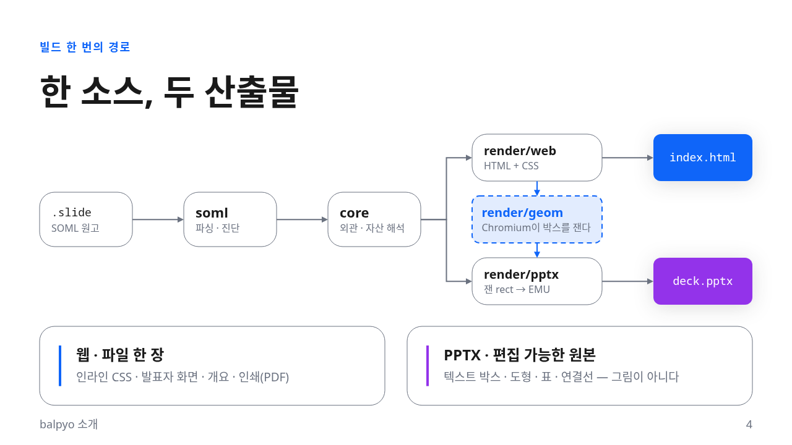 | 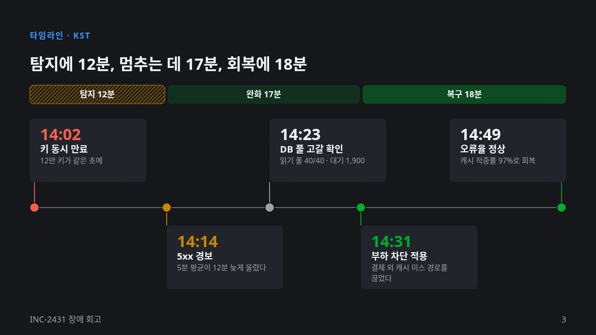 |
| `<connector>` 도식 — PPTX에서 상자에 붙은 연결선이 된다 · [`balpyo-intro`](examples/decks/balpyo-intro) | 비례하는 시간 축 — `<stack>` 위의 깃발 카드 · [`incident-postmortem`](examples/decks/incident-postmortem) (`ink`) |
| 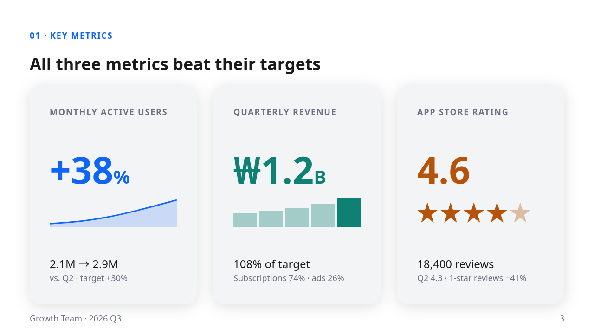 |  |
| `type="path"` 곡선 · 막대 · `star` — 전부 편집 가능한 도형 · [`quarterly-review`](examples/decks/quarterly-review) | `image-text` 레이아웃 — 그림은 PPTX 플레이스홀더가 된다 |
| 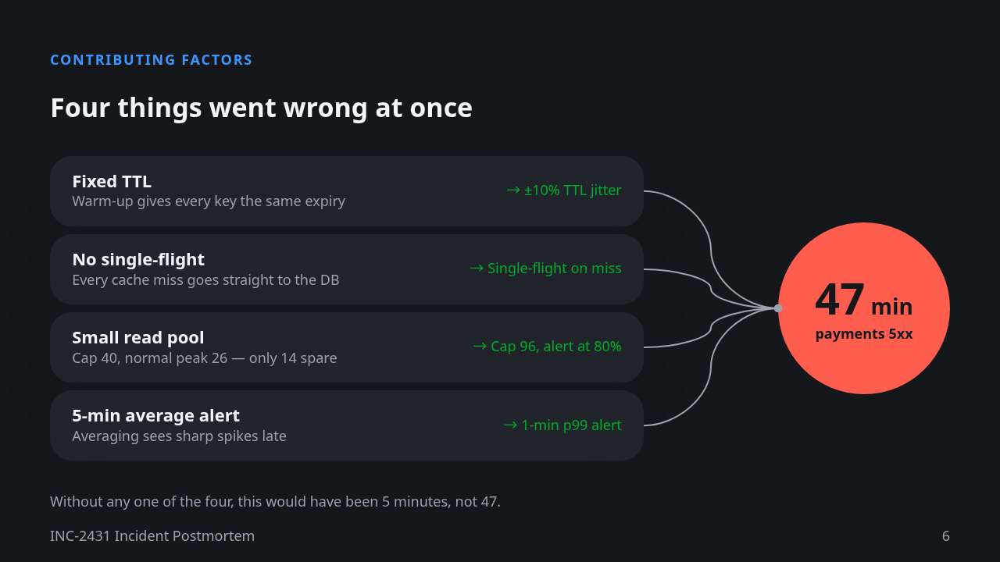 | 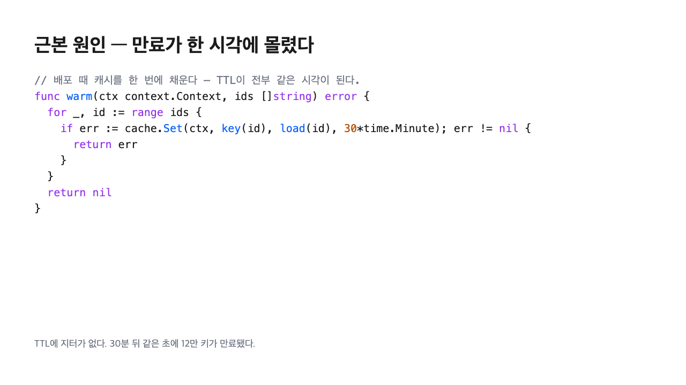 |
| 곡선 연결선이 한 결과로 모인다 | `<pre lang="go">` — 하이라이팅이 PPTX 글자 런으로 간다 |
| 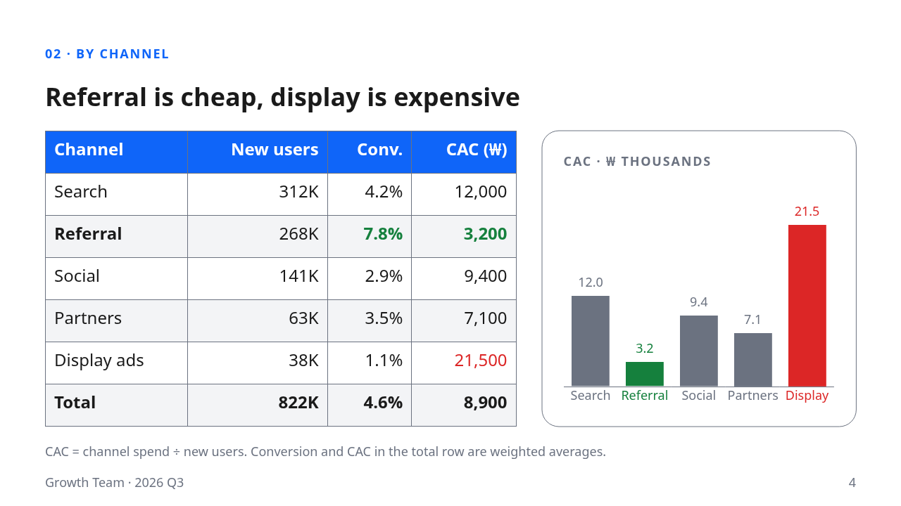 | 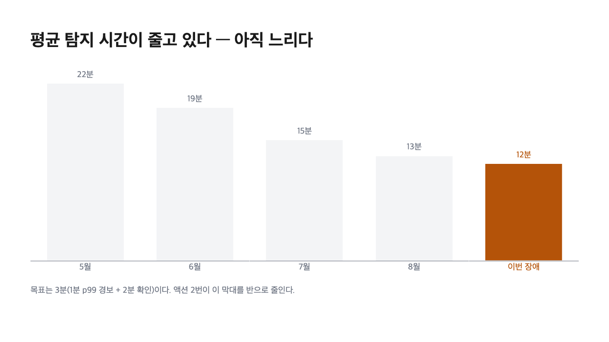 |
| `<table>`과 `<chart>` — 둘 다 PPTX에서 고칠 수 있다 | 계열 둘의 `<chart>`와 범례 |
|  | 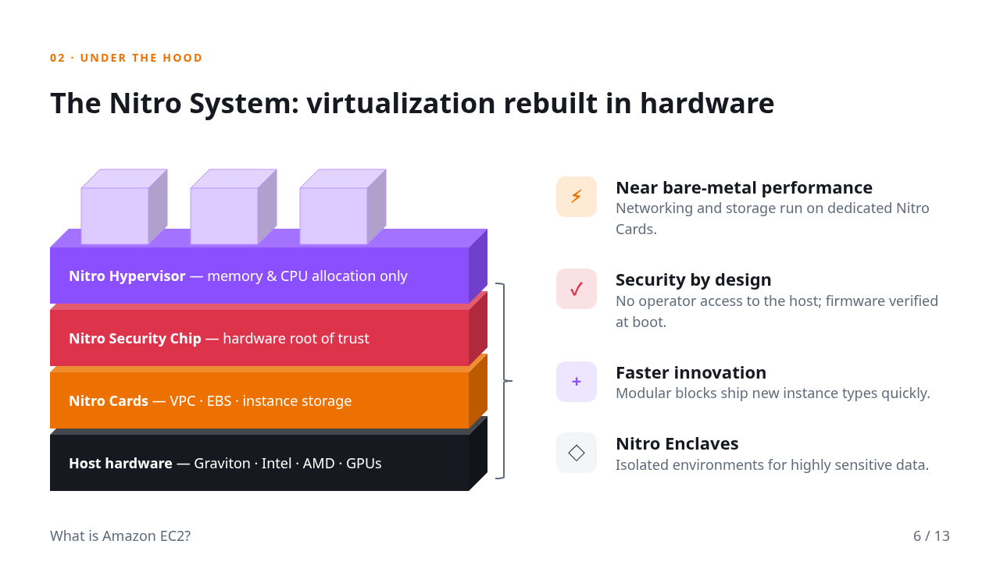 |
| 배경 덮개(`radial()`)와 그라디언트 글자 · [`ec2-intro`](examples/decks/ec2-intro) | `cube` · `right-brace` 프리셋 — PPTX에서도 같은 도형이다 |
| 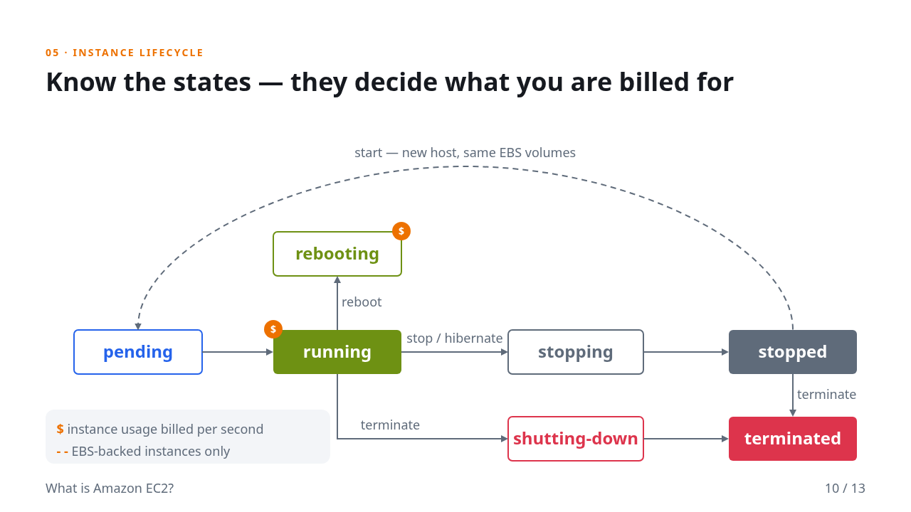 | 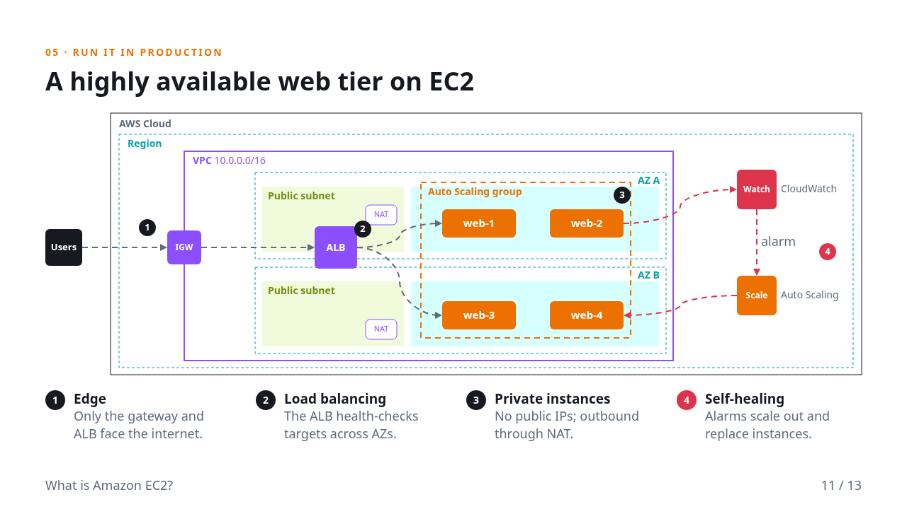 |
| 상태 기계 — 직선 · 꺾인 선 · U자 곡선 연결선 | 중첩한 영역과 흐르는 연결선(`flow`) |

### 같은 슬라이드, 다른 테마

슬라이드 파일은 그대로 두고 테마만 바꿨다 (`balpyo build --theme <이름>`). 슬라이드는 색 대신
`accent1` · `surface` 같은 **토큰 이름**과 `card` 같은 **variant**를 쓰므로, 그 값을 정하는 테마가
바뀌면 같은 원고가 다른 덱이 된다.

```xml
<slide id="geometry" enter="rise">
  <text variant="kicker">Geometry pass</text>
  <h1>The browser computes the coordinates</h1>
  <grid cols="3" gap="lg" grow="1">
    <shape variant="card" type="rounded-rect" w="fill" pad="md">
      <col gap="sm" h="fill" justify="between">
        <shape variant="card-header" type="rounded-rect" fill="accent1" w="fill" h="44" pad="xs">
          <text color="bg" align="center" anchor="center"><strong>① Declare</strong></text>
        </shape>
        <pre lang="soml" size="14">&lt;row gap="md"&gt; …</pre>
        <p size="20">Authors declare layout with flex and grid. Coordinates have no place in it.</p>
      </col>
    </shape>
    <!-- … 카드 두 장 더 … -->
  </grid>
</slide>
```

| `minimal` (기본) | `editorial` |
|---|---|
| 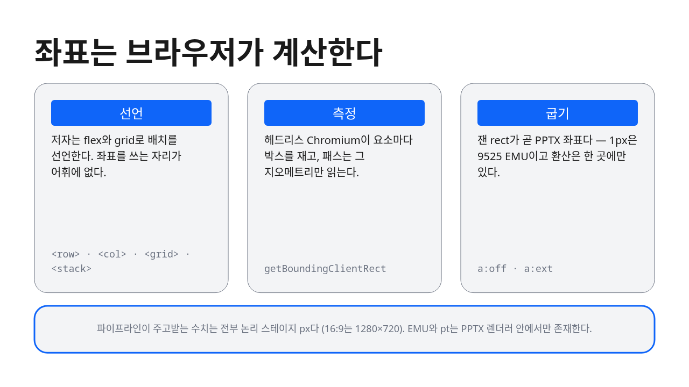 | 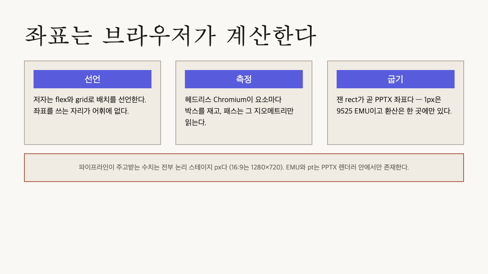 |
| **`ink`** | **`harbor`** ([예제 테마](examples/themes/harbor)) |
| 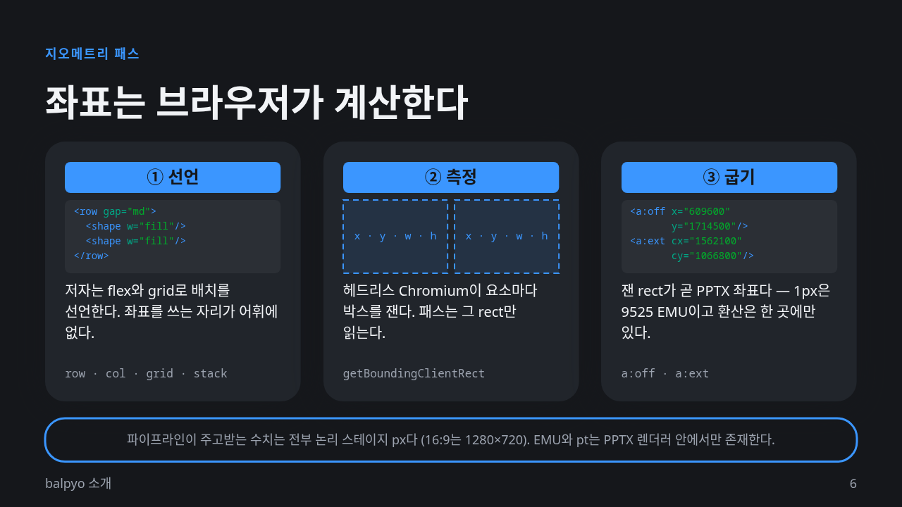 | 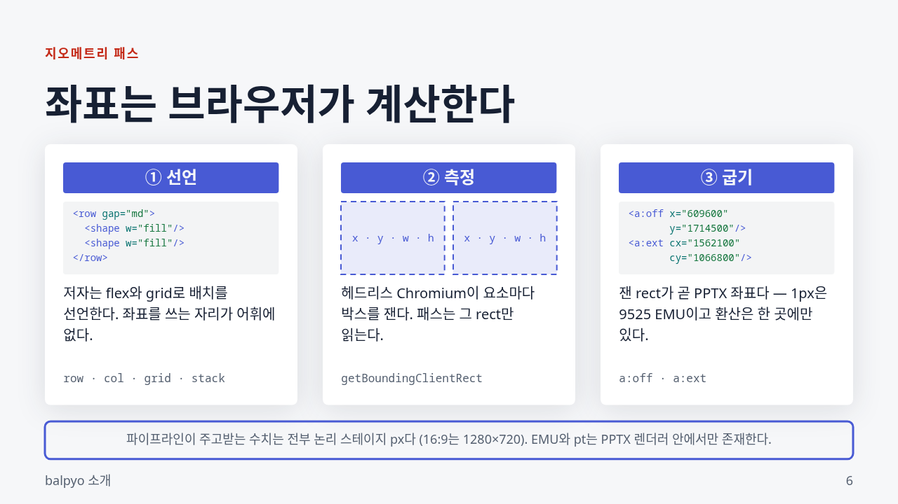 |
| **`aurora`** ([예제 테마](examples/themes/aurora)) | **`aurora`** — 다른 덱의 사진 장 |
|  |  |

테마는 색만이 아니라 **자리**와 **그림**도 소유한다. 같은 표지 원고가 minimal에서는 가운데,
editorial에서는 아래, ink에서는 왼쪽 가운데, harbor에서는 위 왼쪽에 선다 — 표지 원고에는 정렬이
한 줄도 없다. aurora는 표지 · 마무리 장의 배경 그림까지 갖고 온다: 덱은 그림을 한 번도 부르지 않는다.

| `minimal` | `editorial` |
|---|---|
| 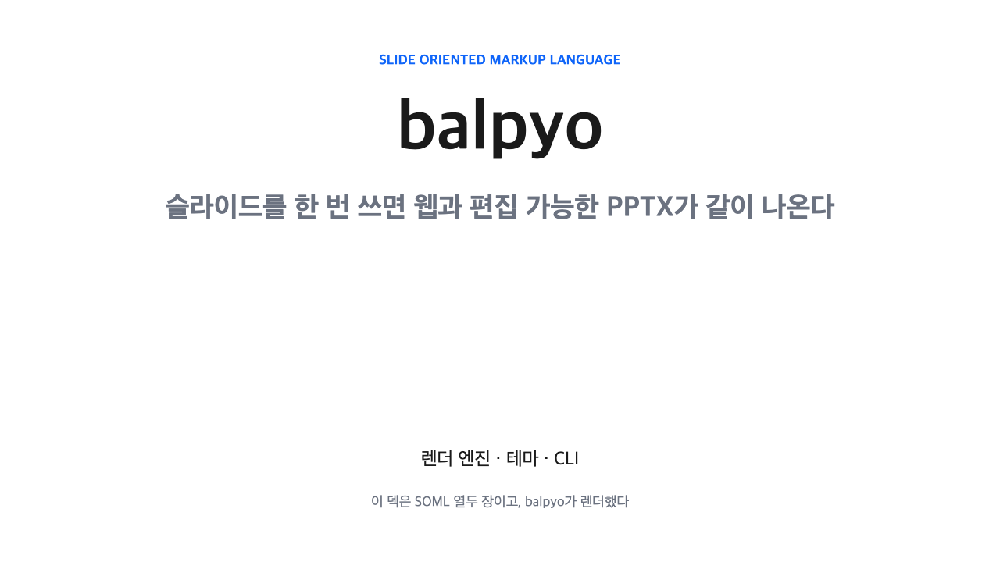 | 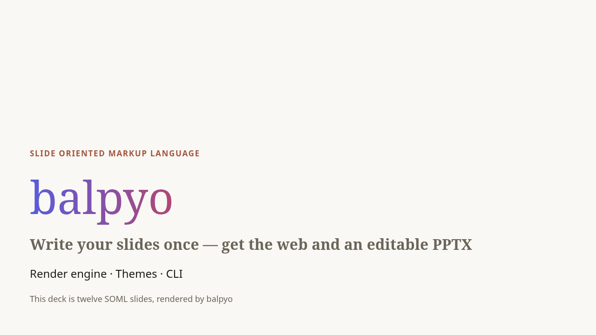 |
| **`ink`** | **`harbor`** |
| 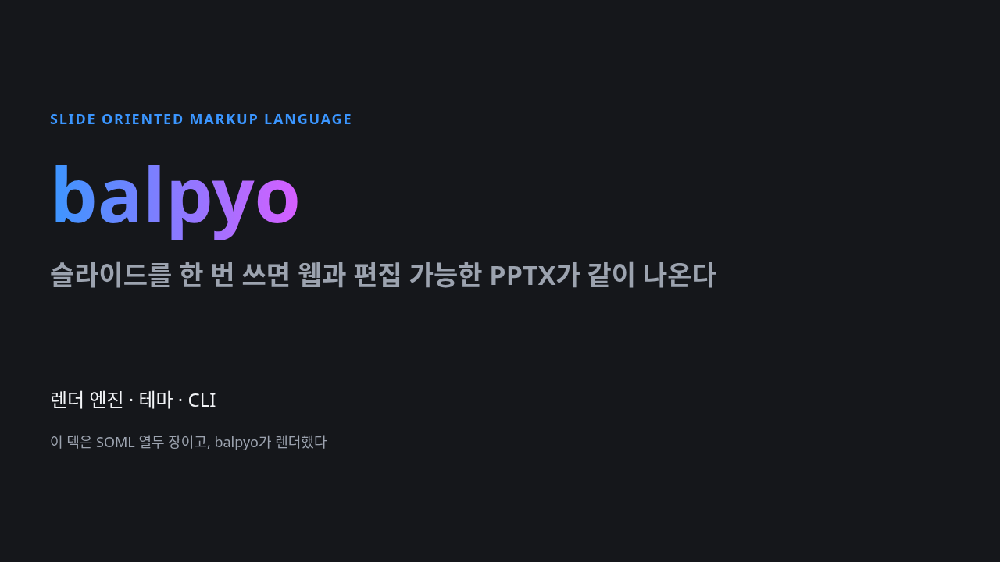 |  |
| **`aurora`** — 표지 | **`aurora`** — 마무리 장 |
|  | 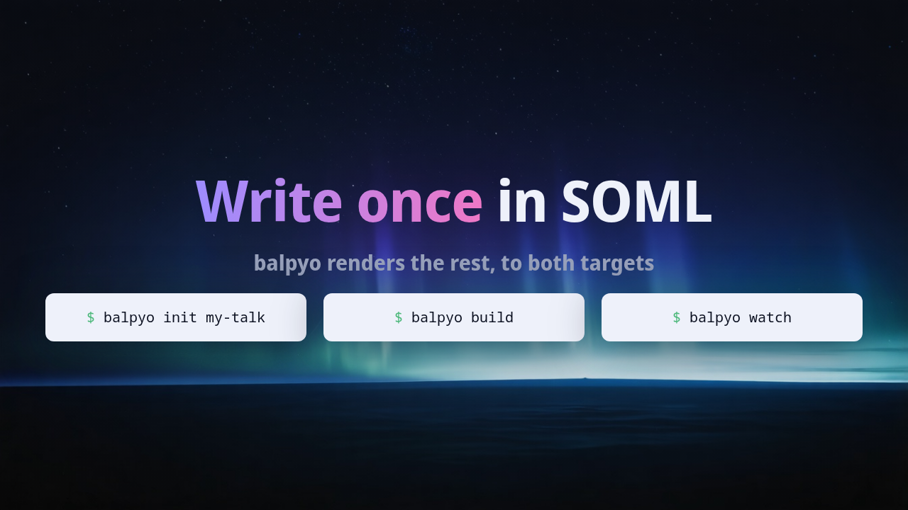 |

## 더 읽을 것

문서 사이트는 **https://k2sebeom.github.io/balpyo/** 다.

- [개요](docs/index.md) — balpyo가 무엇이고 어떻게 동작하는가
- [시작하기](docs/guides/getting-started.md) — 설치부터 발표까지
- [레퍼런스](docs/reference/index.md) — 태그 · 외관 속성 · 레이아웃 · 테마 패키지 · CLI
- [테마 고르기 · 만들기](docs/guides/theming.md) — 내장 테마 셋과 자기 테마
- [예제](examples/) — 완성된 덱 넷과 혼자 서는 테마 둘

## 기여

balpyo를 고치는 사람을 위한 문서는 [`contributing/`](contributing/)에 있다 — 아키텍처, 지오메트리
패스, 테스트, 설계 결정(ADR), 백로그. 게이트는 `go test ./...` 하나다. 렌더 결과가 바뀌면
`make showcase`로 위의 쇼케이스를 다시 만들어 함께 커밋한다.
